# Neural Network Models as Othello Players

Deep-learning project (ENSIM, Le Mans Université, 2025/2026): train neural networks to **imitate human Othello players** by predicting the next move from the current board, then compare MLP, LSTM and CNN architectures through a systematic hyper-parameter study.

<p align="center">
  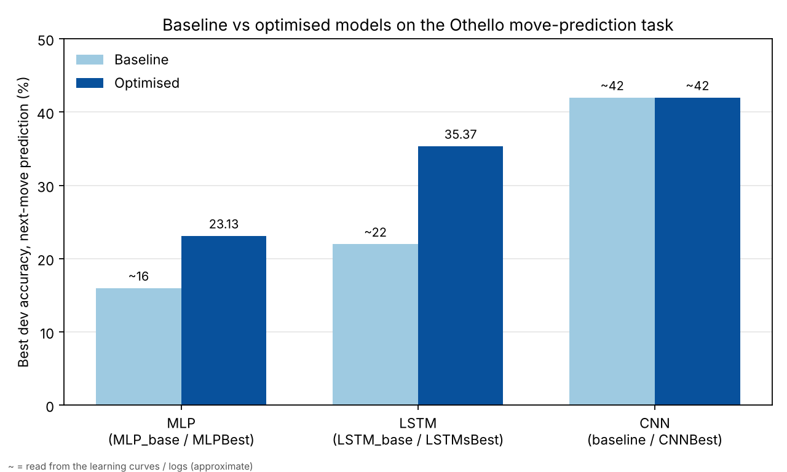
</p>

**Author:** Essomba Jabe Michael Marie · **Supervisor:** Meysam Shamsi

---

## Highlights

- **Task:** given a board state, output an 8×8 probability map of the next move; the move played is the highest-probability cell among the *legal* moves.
- **Data:** 8 399 complete human games (60 moves, no pass), split 70 % train / 15 % dev / 15 % test.
- **Models:** MLP, bidirectional LSTM over the last 5 boards, and a 3-block CNN, each with a baseline and a tuned version.
- **Study:** hidden size, dropout, learning rate, batch size and optimiser were varied one at a time (30 MLP and 30 LSTM variants, about 15 CNN variants).
- **Result:** tuning gains +7 points for the MLP and +13 points for the LSTM; the CNN, which exploits the 2-D structure of the board, reaches about 42 % dev accuracy.

## Results at a glance

| Model | Architecture | Best dev accuracy |
|---|---|---|
| MLP_base | 64 → 128 → 128 → 64, GELU, dropout 0.1 | ≈ 16 % |
| **MLPBest** | 64 → 512 → 512 → 256 → 64, BatchNorm, GELU, dropout 0.3 (> 4.2·10⁵ params) | **23.13 %** (epoch 76) |
| LSTM_base | 1-layer LSTM + Linear | ≈ 22 % |
| **LSTMsBest** | 2-layer **bidirectional** LSTM, H = 256, dropout 0.3, MLP head, input = 5 boards | **35.37 %** (epoch 43) |
| CNN baseline | 3 × [Conv3×3 + BN + ReLU] (16-32-64) → Linear(128) → dropout 0.4 | ≈ 42 % (100 epochs) |
| **CNNBest** (`CNN_V3`) | same conv stack, tuned dense width / dropout / optimiser, Adam | ≈ 42 % (50 epochs) |

> Metric = top-1 accuracy of the predicted move against the move actually played by the human. Human moves are noisy, so this measures *imitation*, not playing strength; strength is evaluated by head-to-head games (`game.py`, `tournois_*.py`).

## Learning curves

<table>
  <tr>
    <td align="center"><b>MLPBest</b><br>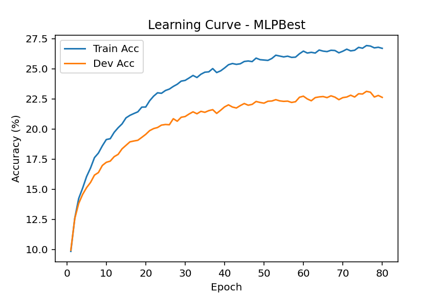</td>
    <td align="center"><b>LSTMsBest</b><br>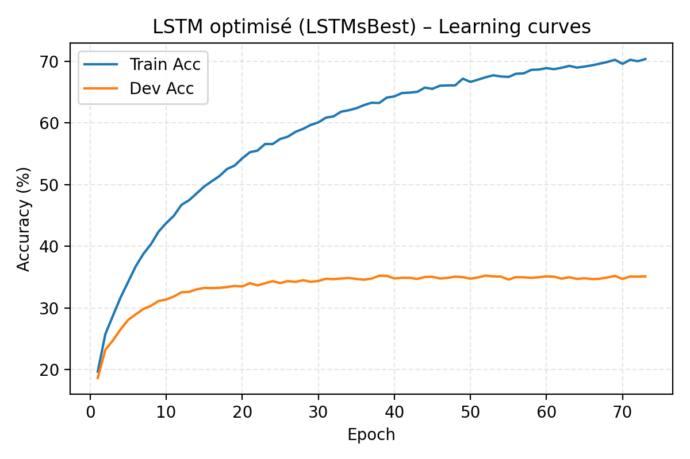</td>
  </tr>
  <tr>
    <td align="center"><b>CNN baseline</b><br>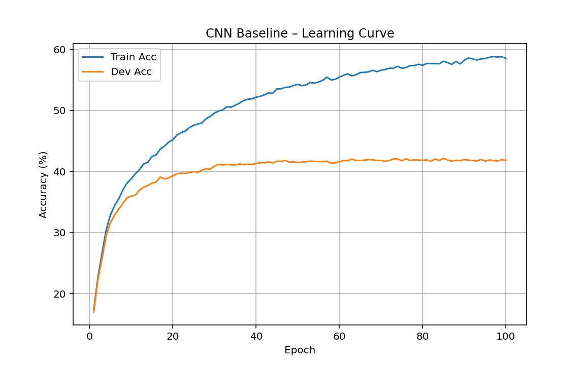</td>
    <td align="center"><b>CNNBest</b><br>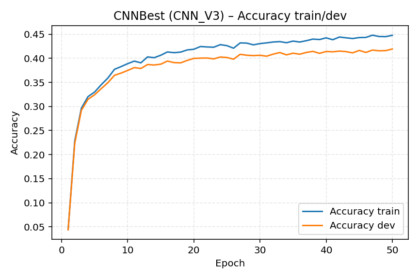</td>
  </tr>
</table>

Observations:

- **MLPBest** keeps a small train/dev gap (≈ 3–4 points): BatchNorm and dropout 0.3 regularise well, but the model plateaus near 23 %.
- **LSTMsBest** reaches ≈ 70 % train accuracy while dev saturates at ≈ 35 % after about 40 epochs, i.e. a large generalisation gap. Early stopping on dev accuracy is essential.
- **CNN** curves converge fast and the train/dev gap stays moderate (≈ 3 points for CNNBest), which makes it the best-generalising family in this study.

### Loss curves

<table>
  <tr>
    <td align="center"><b>MLPBest</b><br>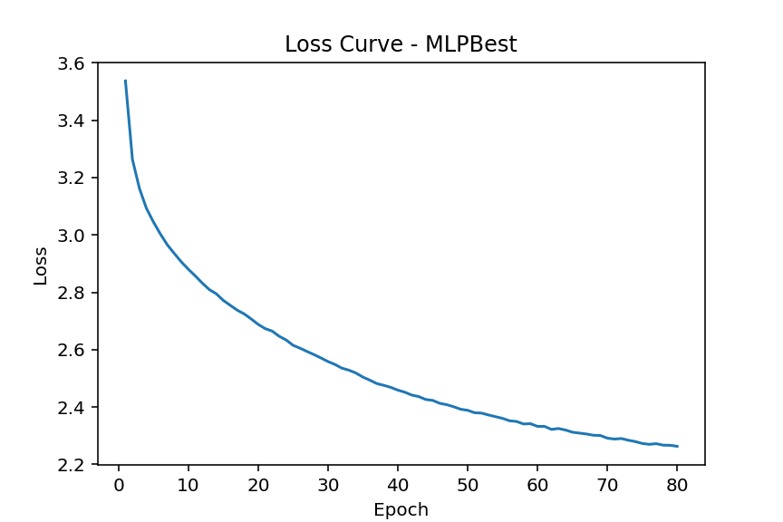</td>
    <td align="center"><b>LSTMsBest</b><br>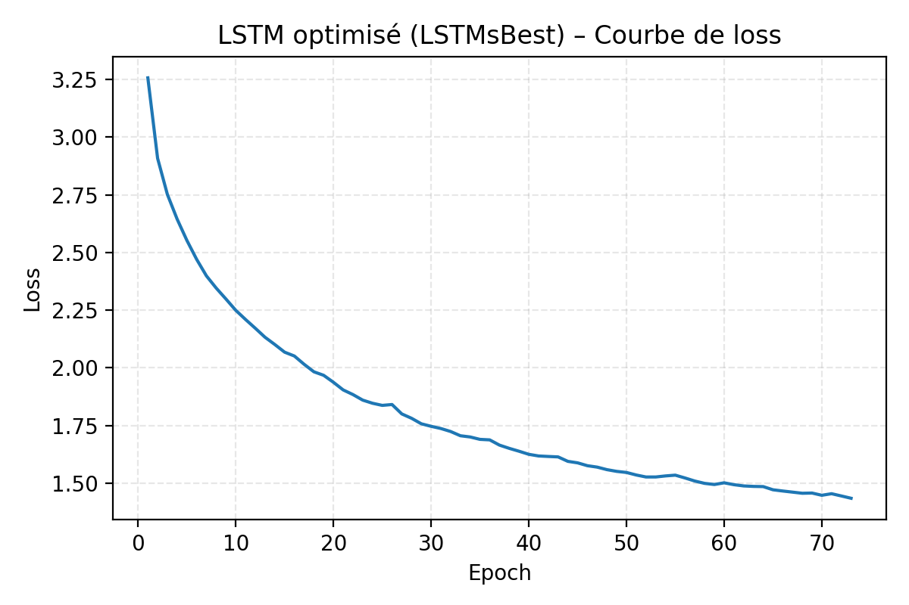</td>
    <td align="center"><b>CNNBest</b><br>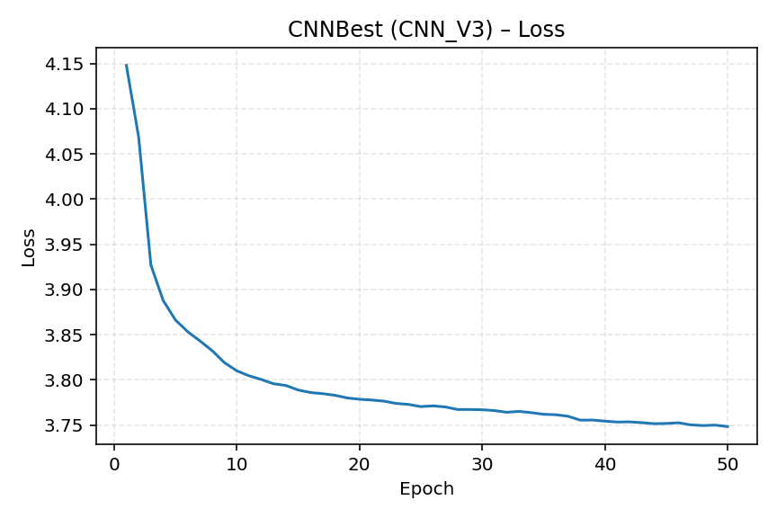</td>
  </tr>
</table>

## Hyper-parameter study (LSTMsBest)

<table>
  <tr>
    <td align="center"><b>Learning rate</b><br>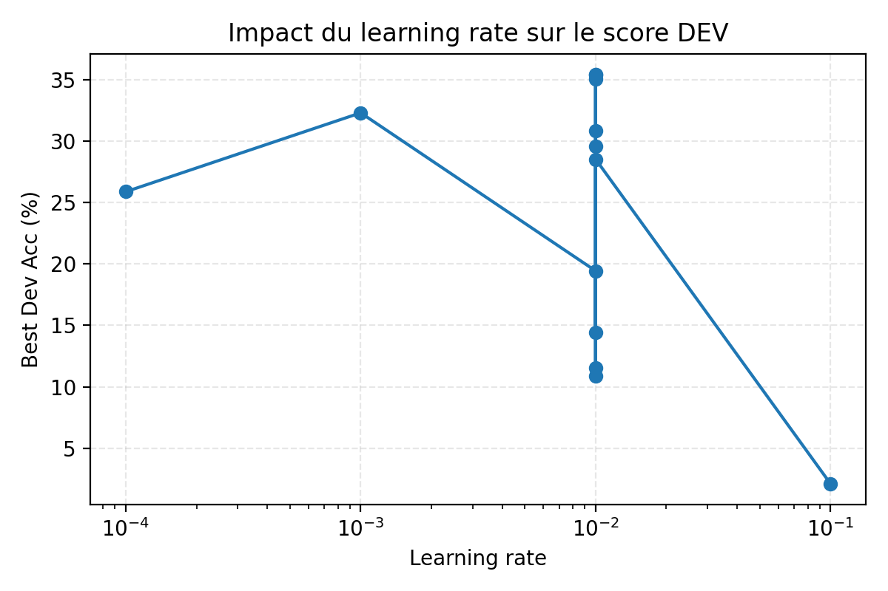</td>
    <td align="center"><b>Batch size</b><br>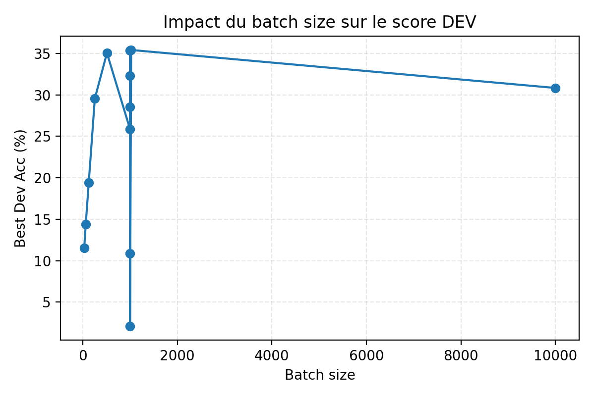</td>
    <td align="center"><b>Optimiser</b><br>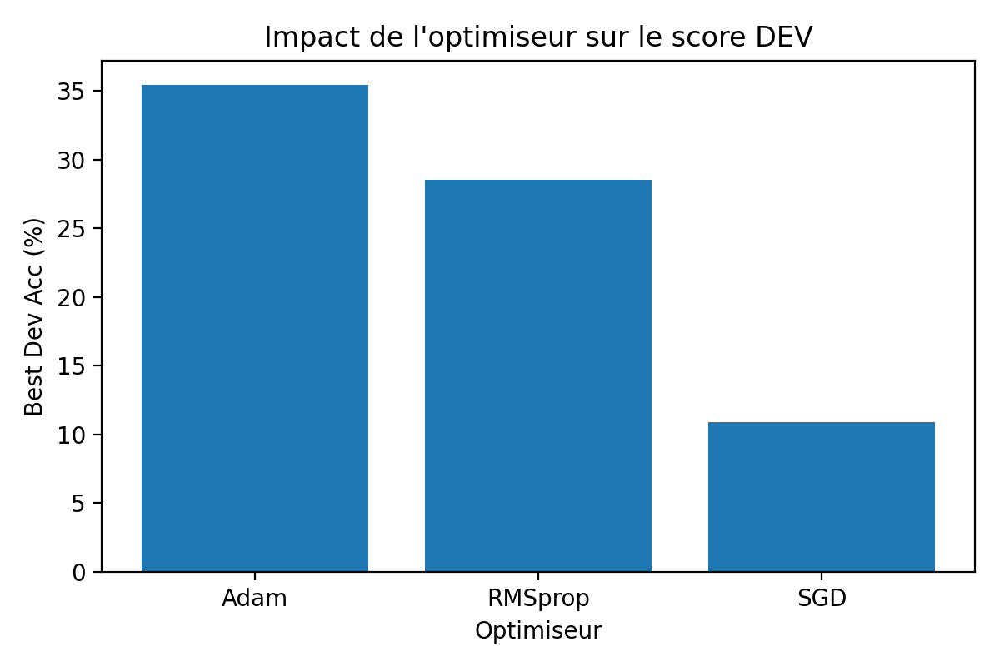</td>
  </tr>
</table>

**Learning rate** (Adam, batch 1000)

| lr | Best dev acc | Best epoch |
|---|---|---|
| 1e-4 | 25.87 % | 50 |
| 1e-3 | 32.29 % | 47 |
| **1e-2** | **35.37 %** | 43 |
| 1e-1 | 2.11 % (diverges) | 14 |

**Optimiser** (lr 0.01, batch 1000)

| Optimiser | Best dev acc | Best epoch |
|---|---|---|
| SGD | 10.86 % | 50 |
| RMSprop | 28.51 % | 48 |
| **Adam** | **35.37 %** | 43 |

**Batch size** (Adam, lr 0.01)

| Batch size | Best dev acc | Best epoch |
|---|---|---|
| 32 | 11.55 % | 9 |
| 64 | 14.40 % | 22 |
| 128 | 19.43 % | 29 |
| 256 | 29.55 % | 50 |
| 512 | 30.35 % | 50 |
| **1000** | **35.37 %** | 43 |

## Capacity and regularisation (baseline MLP / LSTM)

| hidden_dim | MLP dev acc | LSTM dev acc |
|---|---|---|
| 32 | 12.13 % | 16.29 % |
| 64 | 14.83 % | 17.67 % |
| 128 | 16.65 % | 18.76 % |
| 256 | 18.49 % | 19.69 % |
| 512 | 20.66 % | 21.28 % |
| 1024 | – | 22.06 % |

| Dropout | 0.00 | 0.05 | 0.15 | 0.20 | 0.30 | 0.50 | 0.70 | 0.90 |
|---|---|---|---|---|---|---|---|---|
| **MLP** (hidden 128) | 18.88 | 19.77 | **20.52** | 20.13 | 18.77 | 16.68 | 13.18 | 8.56 |
| **LSTM** (hidden 128) | 18.76 | 19.51 | 19.10 | 18.93 | 19.16 | 19.64 | 18.63 | 19.60 |

The MLP is sensitive to dropout (best around 0.15–0.20, collapses above 0.5) whereas the LSTM is almost insensitive to it. Larger hidden sizes keep helping both models, at a higher compute cost.

## Key findings

1. **Optimiser and learning rate matter most.** Adam with lr = 10⁻² beats RMSprop by ≈ 7 points and SGD by ≈ 25 points on the same architecture; lr = 10⁻¹ diverges.
2. **Large batches work better here** (1000 > 512 > 256 ≫ 32), with the same early-stopping protocol.
3. **Structure beats width.** The flat MLP stays far below the models that exploit board geometry (CNN) or move history (LSTM), even with 12× more parameters than its baseline.
4. **Regularisation is model-dependent:** crucial for the MLP, secondary for the LSTM.

## Data format

Each game is one `.h5` file holding an array of shape `(2, 60, 8, 8)`:

- index `0` — the 60 successive **board states** (`0` empty, `+1` player 1, `-1` player 2),
- index `1` — the 60 **moves**, one-hot 8×8 arrays.

To let one network play both colours, the board is multiplied by `-1` when black is to move, so the model always sees itself as white. At inference the 8×8 output is masked by the legal moves and the arg-max is played.

## Repository layout

```
.
├── networks_e2404931.py   # network definitions (MLP, LSTM, CNN variants)
├── data.py, utile.py      # data loading / pre-processing and game rules
├── game.py                # plays two models against each other, writes a GIF log
├── training*.py, trainCNN.py, suite_training.py
│                          # training entry points
├── generate_*.py, hyper*.py
│                          # generation of the model variants and hyper-parameter searches
├── tournois_*.py          # model-vs-model tournaments
├── results/               # CSV exports of the experiments
├── logs/                  # training logs (per-epoch accuracy / loss / time)
├── docs/                  # course statement (and report if exported)
├── assets/                # figures used in this README
├── dataset/               # NOT versioned: put the .h5 games here
└── requirements.txt
```

Files that a script reads or writes by name are kept at the repository root.

## Getting started

```bash
git clone <this-repo>
cd othello-nn-player
python -m venv .venv
source .venv/bin/activate          # Windows: .venv\Scripts\activate
pip install -r requirements.txt
```

**Dataset.** The 8 399 `.h5` games are not stored in this repository. Download the course package
(<https://git-lium.univ-lemans.fr/mshamsi/deeplearning2playothello>) and copy the games into `dataset/`.

**Train** — pick a training script and run it from the repository root, e.g. `python trainCNN.py`
(check the header of each script for the model class, optimiser, learning rate, batch size and number of epochs).

**Play** — `game.py` plays a match between two models (twice, with the colours swapped, as in the course statement) and saves a GIF log;
the `tournois_*.py` scripts organise tournaments between trained models.

## Limitations and next steps

- Accuracy is measured on move imitation; a systematic win-rate evaluation across all final models is still to be reported.
- Not yet explored: a **hybrid CNN-LSTM**, **attention / Transformer** models, and **self-play** to enlarge the dataset.
- Candidate improvements: deeper CNNs with stronger regularisation, learning-rate schedules (cosine annealing, warm-up) and data from late-game positions.

## Acknowledgements

Baseline package, game engine and dataset pre-processing by Meysam Shamsi (ENSIM, Le Mans Université). Original games come from a public Kaggle Othello dataset.
